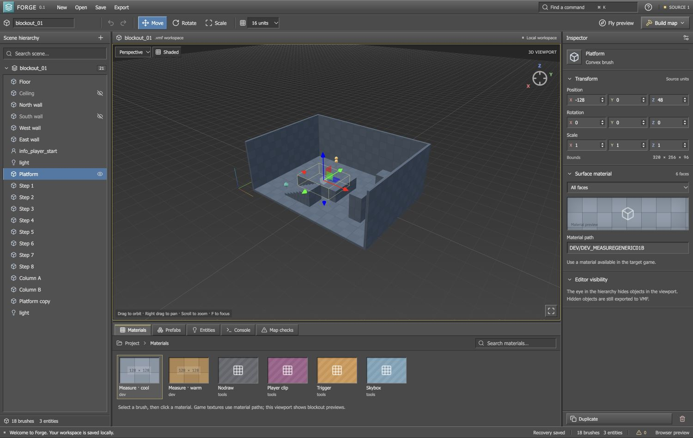

# Forge — Source 1 Editor

[](LICENSE)
[](https://github.com/baiehclaca/forge-source-editor/actions/workflows/ci.yml)

[Download](https://github.com/baiehclaca/forge-source-editor/releases) · [Report a bug](https://github.com/baiehclaca/forge-source-editor/issues/new/choose) · [Contribute](CONTRIBUTING.md)

A runnable desktop editor foundation with an Unreal/Unity-style workspace for native Source 1 maps. Version 0.1 is an early development release, not a complete Hammer replacement. The interface uses a classic gray desktop theme inspired by the supplied 3ds Max 2016 reference: compact beveled controls, blue tool selection and a yellow viewport outline.



## Start

Download the latest [release](https://github.com/baiehclaca/forge-source-editor/releases), then open **Forge.app** on an Apple Silicon Mac, or extract the Windows portable package and run **Forge.exe**. These local development builds are unsigned. Windows packaging is supplied but has not been run on Windows.

From source, use Node.js 22.12 or later (Node.js 24 is used by CI):

```sh
git clone https://github.com/baiehclaca/forge-source-editor.git
cd forge-source-editor
npm ci
npx install-electron
npm run desktop
```

For the browser editing preview:

```sh
npm run dev
```

Then open http://127.0.0.1:5173. The preview supports editing and downloading files; SDK execution is available in the desktop app.

## What works

- Perspective and orthographic top/front/side viewports; orbit, pan, zoom and free camera navigation.
- Convex brush creation and reconstruction from VMF planes, with move/rotate/scale gizmos and grid snapping.
- Scene hierarchy, visibility controls, object inspector and numeric transforms in Source coordinates: X/Y horizontal, Z up.
- Whole-brush or individual-face material paths with procedural blockout previews.
- Point entities, arbitrary property keys, and repeated Source entity I/O outputs.
- Brush entities imported with their child solids. Their entity transforms are protected; child convex brushes can be edited individually.
- Room, staircase and platform insertion, and project-based prefab save/import.
- Undo/redo (80 steps), local recovery autosave, explicit project files, VMF import/export, and file drop.
- Local geometry/spawn/entity checks, plus a desktop SDK runner with live logs and cancellation.
- Resizable panels and a searchable command menu.

## Build a map

1. Edit the included blockout or create a new map. New/Open operations can be undone in the same session.
2. Save a `.forge` project to preserve editor names, hidden objects and all imported source data.
3. Click **Build map** in the desktop app.
4. Select the SDK bin folder containing VBSP, VVIS and VRAD executables for your game and operating system, and the game folder containing `gameinfo.txt`.
5. Click **Choose output & build** and choose the VMF output file. Forge runs the tools sequentially; output and errors appear in the Console tab. Existing BSP output is backed up before the new build.
6. After successful compilation, use **Reveal BSP**, then put the BSP in the game's `maps` folder and load it in-game.

Forge does not bundle the SDK, game content, textures, models or engine runtime. The editor runs on macOS; compilation requires executables that actually run on that OS. Windows `.exe` SDK tools cannot be executed directly by the macOS app. Use the Windows package for Windows SDK tools or export a VMF to a separate build machine.

Use **Export** for a VMF without compiling. Use the correct SDK branch and entity classes for Half-Life 2, Garry's Mod, Counter-Strike: Source, or another Source 1 game. The initial room uses `info_player_start`; the Entities tab also includes a GMod-compatible deathmatch spawn marker. Game-specific team spawn classes can be entered in the entity inspector.

## Controls

| Action                | Control                                                                           |
| --------------------- | --------------------------------------------------------------------------------- |
| Orbit / pan / zoom    | Left drag / right drag / mouse wheel                                              |
| Move / rotate / scale | W / E / R                                                                         |
| Add block / focus     | B / F                                                                             |
| Duplicate / delete    | Cmd or Ctrl + D / Delete                                                          |
| Undo / redo           | Cmd or Ctrl + Z / Shift + Cmd or Ctrl + Z                                         |
| Save / open           | Cmd or Ctrl + S / Cmd or Ctrl + O                                                 |
| Commands              | Cmd or Ctrl + K                                                                   |
| Fly camera            | Enable Fly preview, click viewport, WASD; Q/E vertical, Shift faster, Escape exit |

Visibility eyes only affect the editor viewport. Hidden objects are still exported and compiled, allowing a cutaway room to remain sealed. The example hides the ceiling and south wall for editing.

## Current boundaries

- Game materials are represented by paths and color/checker previews. There is no VPK mounting, VTF decoding, MDL rendering, or FGD loading in this release.
- Imported displacements and unsupported or invalid brush solids are protected. Raw displacement blocks are preserved on export; the viewport only displays their underlying brush surface. No displacement editing is provided.
- Imported face UV axes and other side metadata are preserved. There are no UV editing or texture-lock tools; transforming imported geometry keeps its existing world-space UV axes.
- No clipping/CSG, vertex editing, terrain painting, multi-selection, live game synchronization, or Source rendering/physics in the editor. Fly preview is a free camera, not game simulation.
- Unknown VMF chunks, editor metadata, per-side fields and entity outputs are retained. Formatting/comments and placement in hidden wrappers may change; saving a `.forge` project is recommended. Imported instances are retained as entity data but are not expanded or previewed.
- Local checks are not an SDK compiler or a leak detector. Compile and test in the actual target game before treating a map as ready.
- Large-map performance has not been profiled. VMF/project input is limited to 32 MB; complex brush reconstruction is capped at 128 planes per brush, with unsupported solids preserved and protected.
- Autosave stays in local browser/app storage. Explicit `.forge` saves are the portable copy. Imported/opened projects keep an additional previous-project recovery slot.

## Validation

`npm test` covers Source brush winding and bounds, transformed VMF round trips, ID allocation, entity/brush parenting, repeated outputs, unknown chunks, UV preservation, displacement protection, parser errors, project validation and compiler sequencing. SDK tests use local fake executables to verify the process bridge; they do not claim an in-game compilation test.

`npm run build` runs TypeScript checking and produces a self-contained browser build. The browser UI was exercised for selection, transforms, material changes, duplication, undo/redo, orthographic views, checks, commands, exports and reload recovery. The macOS packaged app was launched for a native smoke check. Windows runtime and real SDK/game validation remain outstanding.

## Next development milestones

1. Mount game assets and parse FGDs for a searchable asset browser and class-aware inspector.
2. Add face picking, UV controls, clipping/CSG, vertex editing and displacement authoring.
3. Add typed entity connection editing, instance expansion and reusable multi-object prefab workflows.
4. Integrate game launch, leak pointfiles and build diagnostics, then validate against real maps from each supported Source branch.
5. Add incremental geometry updates, profiling, signed installers and broader platform validation.

## References

- [Valve's Source SDK compiler implementation](https://github.com/ValveSoftware/source-sdk-2013/blob/master/src/utils/vbsp/map.cpp) — VMF plane winding and source format behavior.
- [Valve Developer Community: VVIS](https://developer.valvesoftware.com/wiki/VVIS?uselang=en) — visibility compilation stage.

See `THIRD_PARTY.md` for library attribution. No Valve assets are included.

## Contributing and license

Forge is released under the [MIT license](LICENSE). Bug reports, focused pull requests and real Source SDK compatibility reports are welcome. Read [CONTRIBUTING.md](CONTRIBUTING.md), [ROADMAP.md](ROADMAP.md) and [SECURITY.md](SECURITY.md) before contributing.

Run `npm run package:mac` or `npm run package:windows` to create a desktop package under `release/`. Releases contain unsigned desktop builds, source code and checksums.

## Map properties and environment

Deselect objects to open map properties in the inspector. Set the native `skyname`, edit arbitrary worldspawn properties, create a six-brush sky boundary, or add sunlight, fog and a 3D sky camera. Existing geometry is not removed by the boundary helper. A sky camera requires a separate miniature scene; game textures and the resulting sky are not rendered in the editor yet. Sky surfaces with a blank sky name block compilation; missing sunlight and unexpanded instances are reported in Map checks.

The VMF tree codec and brush geometry are now separated into `src/core/vmf-codec.ts` and `src/core/geometry.ts`; `src/model.ts` remains the compatibility entry point. Map settings live in `src/components/MapSettings.tsx`.
